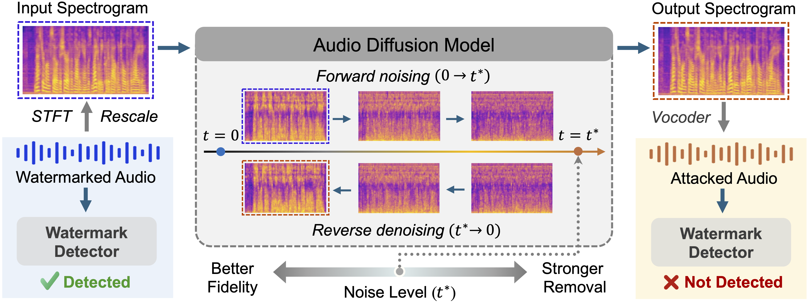

# Audio Pirates: Black-box Audio Watermark Removal via Diffusion Priors
This repository contains the implementation of DiffErase, a method for removing audio watermarks using diffusion-based reconstruction.



We provide two variants:

- **DiffErase-mel**: Mel-spectrogram diffusion. The diffusion model operates directly on mel-spectrograms and reconstructs audio using BigVGAN (see `DiffErase-mel/`).
- **DiffErase-latent**: Latent-space mel-spectrogram diffusion. The diffusion model operates in the latent space of mel-spectrograms and reconstructs audio using HiFi-GAN (see `DiffErase-latent/`).

## Setup

```bash
git clone https://github.com/DiffErase/DiffErase.git
cd DiffErase
pip install -r requirements.txt
```

## Checkpoints

Pretrained checkpoints for speech, music and environmental sound are hosted on [Hugging Face](https://huggingface.co/DiffErase/DiffErase). Download them into the repository root; files are placed in `DiffErase-latent/data/checkpoints/` and `DiffErase-mel/models/`:

```bash
hf download DiffErase/DiffErase --local-dir .
```

| Domain | Training data | DiffErase-mel | DiffErase-latent |
|---|---|---|---|
| `speech` | [LibriSpeech](https://www.openslr.org/12/) | `differase-mel-speech/` | `differase-latent-speech.ckpt` |
| `music` | [FMA](https://github.com/mdeff/fma) | `differase-mel-music/` | `differase-latent-music.ckpt` |
| `env` | [Clotho](https://zenodo.org/records/3490684) | `differase-mel-env/` | `differase-latent-env.ckpt` |

To download only one variant, add `--include "DiffErase-mel/*"` or `--include "DiffErase-latent/*"`. DiffErase-mel also downloads BigVGAN (`nvidia/bigvgan_v2_22khz_80band_256x`) from Hugging Face on first run.

## Remove watermarks

```bash
python remove_differase-mel.py \
  --domain speech \
  --watermarked_dir path/to/watermarked_audio \
  --output_dir path/to/erased_audio \
  --noise_level 0.1

python remove_differase-latent.py \
  --domain speech \
  --watermarked_dir path/to/watermarked_audio \
  --output_dir path/to/erased_audio \
  --noise_level 0.1
```

Here, `--watermarked_dir` is the folder containing watermarked audio to be processed; `--output_dir` is the folder for audio after watermark removal; `--noise_level` controls the diffusion noise level in [0, 1], adjust it to trade off watermark removal strength against audio quality.

## Training

See [`DiffErase-mel/README.md`](DiffErase-mel/README.md) and [`DiffErase-latent/README.md`](DiffErase-latent/README.md).

👉 To listen to the demo, please refer to the [demo webpage](https://differase.github.io/DiffErase/).
